# 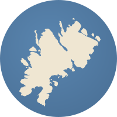 Berlenga

[](https://github.com/pcanilho/berlenga/actions/workflows/release.yml) [](https://github.com/pcanilho/berlenga/actions/workflows/codeql.yml) [](https://github.com/pcanilho/berlenga/releases/latest)

Berlenga is a Godot 4 fork with Vulkan path tracing and DLSS Ray Reconstruction, built for large open worlds. Based on [NVIDIA-RTX/godot](https://github.com/NVIDIA-RTX/godot) (2 November 2026).

**[Download](https://github.com/pcanilho/berlenga/releases/latest):** Windows (Ray Reconstruction: add NVIDIA's DLSS, Streamline and Reflex DLLs next to the exe), Linux x86_64/arm64 (no Ray Reconstruction), macOS (raster only). **Changes:** [CHANGELOG.md](CHANGELOG.md).

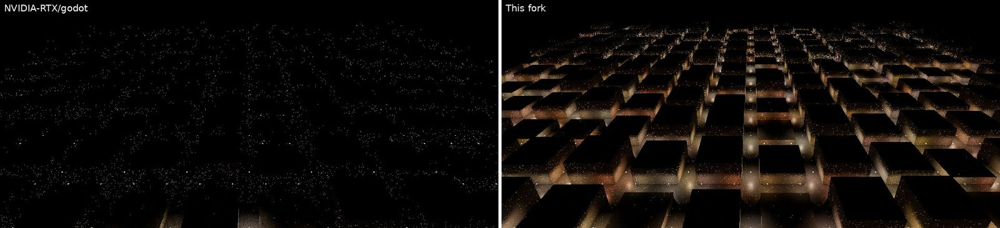

*1024 lights, 16 samples per pixel. Left: NVIDIA-RTX/godot. Right: Berlenga. Images are raw path tracer output, mostly CPU-rendered, without denoiser or Ray Reconstruction.*

## At a glance

- **Lights**: 4096 path-traced lights (upstream 64); emissive surfaces count as lights.
- **Faster convergence**: light visibility memory and a radiance cache.
- **Materials**: clearcoat, back lighting, thin-glass transmission, subsurface scattering, hair; textures filter like raster.
- **Water**: refraction, murky water, caustics, ocean, currents, white water, rivers and waterfalls, shore waves, camera under water.
- **Exposure**: histogram metering, dark-scene key, local exposure.
- **Physics**: PhysX 5 alongside Jolt: cloth, tearing, destruction, path-traced smoke.
- **Open worlds**: camera-relative tracing, persistent instances, culling, mesh LOD.

## What Berlenga adds

Each feature that changes the look or the cost can be turned off with the setting shown.

### Lighting
- **4096 lights** (upstream 64): camera-following light grid with resampled importance sampling.
- **Emissive surfaces as lights** (`rendering/pathtracing/emissive_lights`).
- **Light visibility memory** (`rendering/pathtracing/light_visibility_memory`): hidden lights stop taking samples.
- **Radiance cache** (`rendering/pathtracing/radiance_cache`): bounces end on cached light.
- Shadow-only casters bounce light.
- Lit raster transparents and rain (`rendering/pathtracing/max_transparency_layers` 0), still traced in reflections.

### Materials
- **Back lighting** (`rendering/pathtracing/back_lighting`): light through leaves, paper and curtains, with coloured shadows; back light texture.
- **Transmission** (BaseMaterial3D section, `rendering/pathtracing/transmission`): thin glass, tinted and blurred by roughness, with tinted shadows; transmission texture; `TRANSMISSION` in shaders; glTF `KHR_materials_transmission`.
- **Clearcoat** (`rendering/pathtracing/clearcoat`): matches raster, with traced coat reflections; coat texture.
- **Subsurface scattering** (`rendering/pathtracing/subsurface_scattering`, radius `subsurface_scattering_scale`): random walk inside closed meshes; skin, wax and marble soften and thin parts glow when backlit.
- **Hair** (BaseMaterial3D Hair section, `rendering/pathtracing/hair`): Chiang fibre scattering on mesh and card hair; colour from albedo or melanin; mask for single-material characters.
- **Strand hair** (`HairGroom`, `HairMesh`; Hair direction Strands): grown on a scalp mesh or loaded from a HAIR file, drawn as crossed strips, shaded per fibre under path tracing.
- Shaders writing `BACKLIGHT` or `TRANSMISSION` tint their shadows.
- Textures filter like raster (ray cones, anisotropic).
- Even, tinted glass shadows.
- Back-face normals in `vertex()`; `IN_SHADOW_PASS` in custom shaders.

<details><summary>Images: transmission, back lighting, clearcoat, layer textures, subsurface scattering, hair, strand hair</summary>

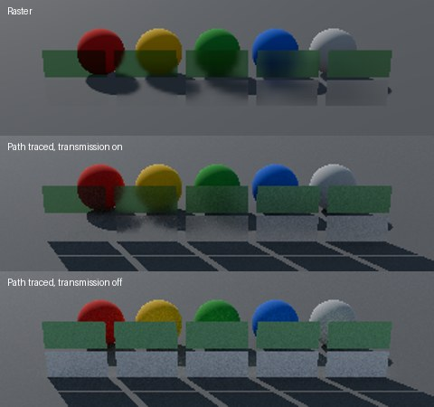

*Transmission: the spheres show through and the floor gets green-tinted light.*

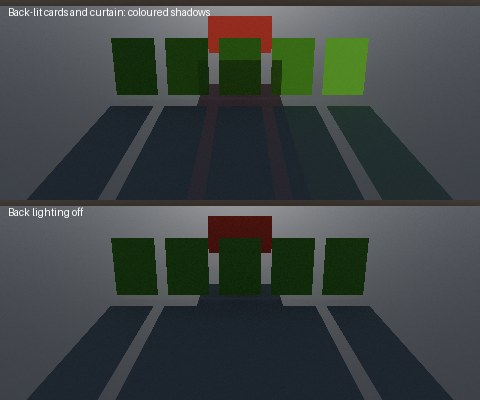

*Back lighting: green and red light on the floor.*

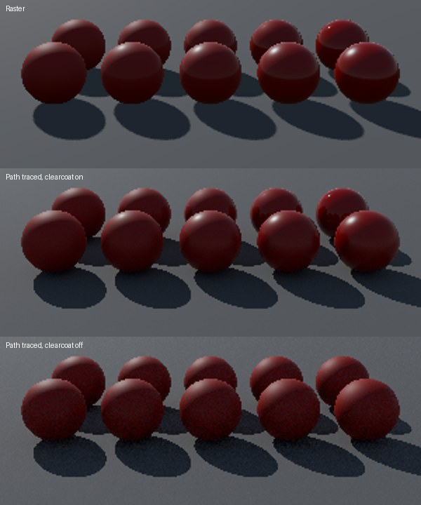

*Clearcoat: sharp coat highlights, as in raster.*

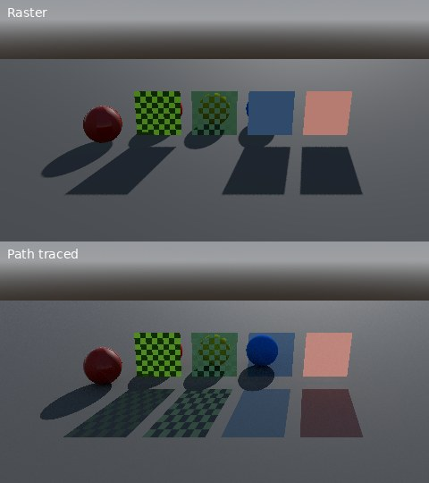

*Layer textures: checkered coloured shadows.*

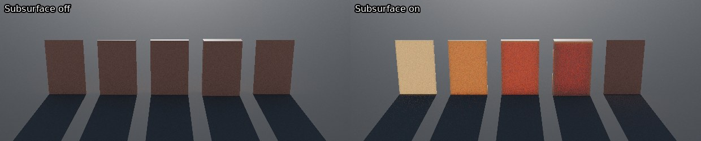

*Subsurface scattering: thin slabs glow, thick ones stay dark.*

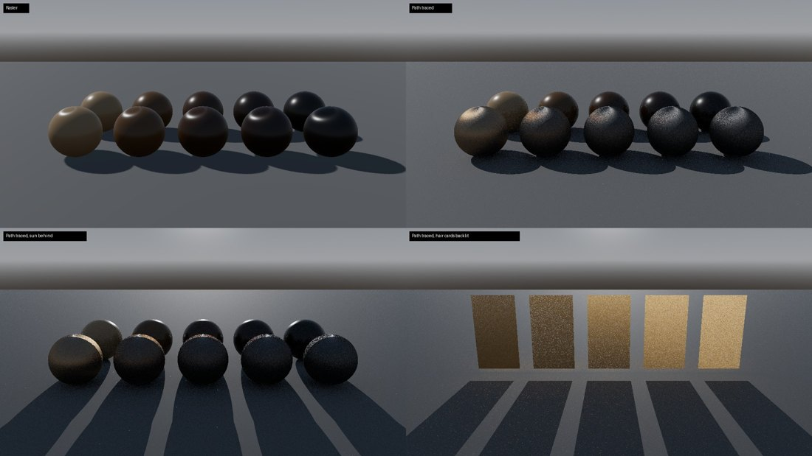

*Hair: fibre highlights and a bright rim against the sun.*

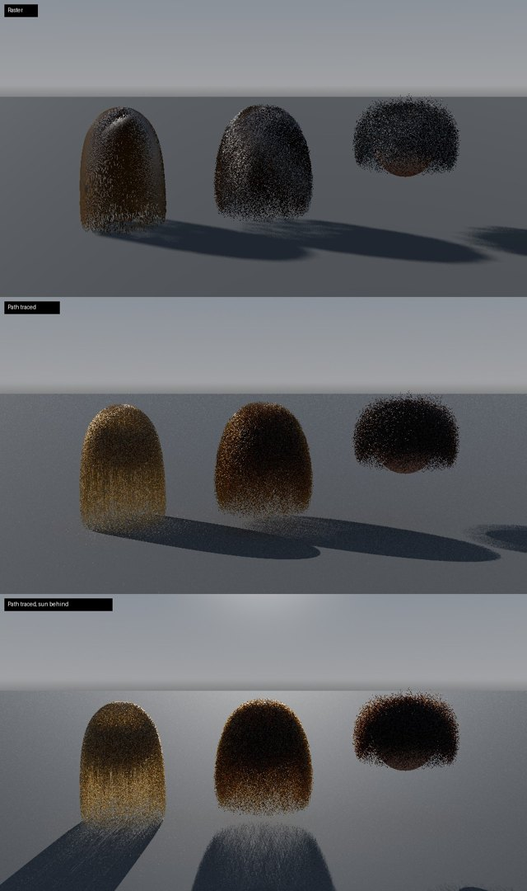

*Strand hair: per-fibre colour and a backlit rim.*

</details>

### Water
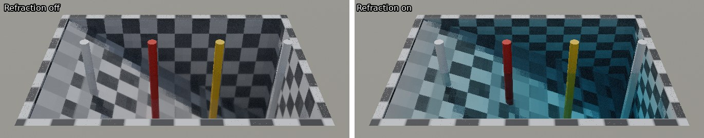

*Refraction off, then on: the posts shift at the surface and the floor darkens with depth.*

- **Refraction** (`rendering/pathtracing/refraction`): water and glass blocks bend light by their IOR, with total internal reflection and depth tint; glTF `KHR_materials_volume`, `KHR_materials_ior`.
- **Murky water** (same setting): scattering media; `IOR`, `ABSORPTION` and `SCATTERING` in shaders; glTF `KHR_materials_scatter` draft.
- **Caustics** (`rendering/pathtracing/caustics`): sunlight lines under rippled water.
- **Path-traced ocean** (`PhysXWaterSurface3D`: `pathtraced_absorption`, `pathtraced_scattering`, `pathtraced_roughness`): waves refract, tint and scatter, with caustics on the seabed.
- **Ocean swell** (`wave_cascades`): up to four wave layers give long swell under the chop without visible tiling, on a shallow-water (TMA) spectrum; set `depth` to the real depth for open sea (the 3 m default damps long waves).
- **Shore waves** (`shore_waves`): swell turns with the seabed, grows in the shallows and breaks on the beach.
- **Currents** (`current`, `flow_period`): flow round rocks and along shores carries waves, foam and floating objects.
- **Live flow** (`live_flow`, `wall_friction`): near the player, rocks and banks shed wakes and eddies.
- **White water** (`flow_foam`): foam in fast water, trailing rocks and drifting downstream.
- **Rivers** (`PhysXRiver3D`: `discharge`, `roughness`, `max_slope`): drawn as a curve; finds its depth and never runs uphill.
  - Cascades into white water; `carve` emits channel brushes for a terrain deformer.
  - Rocks part the current and trail foam (`obstacle_collision_mask`); near the camera they shed eddies and a swinging wake (`live_flow`).
  - Joins lakes, the sea and other rivers (`mouth_target`), ponding to the water level; tributaries add their flow.
  - Waterfalls (`fall_min_height`): a falling sheet that thins, whitens and breaks up, with a boiling pool and spray.
  - Living waterline (`edge_lap_height`, `edge_relief`, `edge_foam`): edges lap with the flow, look ragged and carry a thin foam band.
- **Camera under water** (path traced automatically; raster with `underwater_enabled`): fog, scattering, Snell's window, image split at the water line.

<details><summary>Images and clips: murky water, caustics, ocean, currents, live flow, white water, rivers, under water</summary>

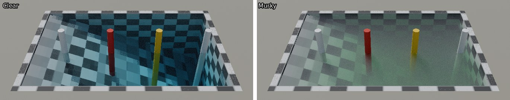

*Murky water: a green glow fills the deep end.*

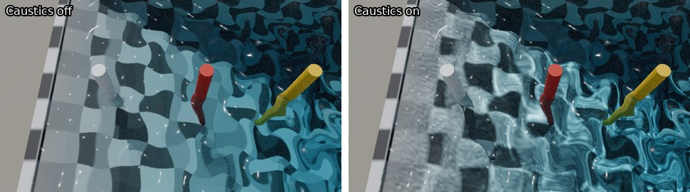

*Caustics: bright lines on the pool floor.*

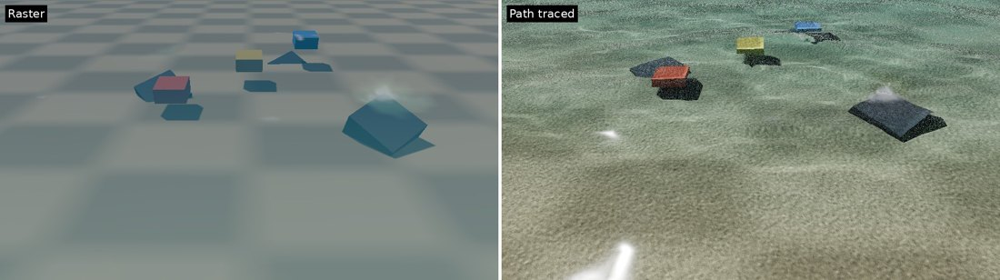

*Ocean: sand and caustic light through the water.*

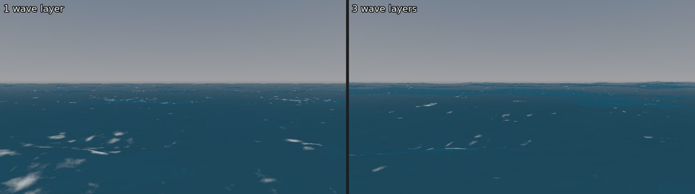

*Ocean swell: one layer repeats the same foam patches; three layers add long swell.*

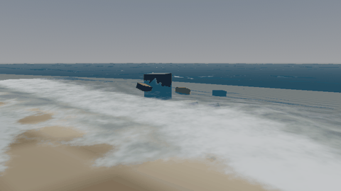

*Shore waves: swell breaks into foam on the beach.*

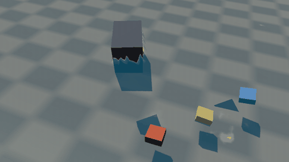

*Currents: the boxes drift past the rock.*

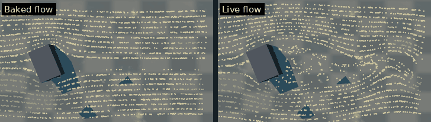

*Live flow: the streaks roll up into a wake behind the rock.*

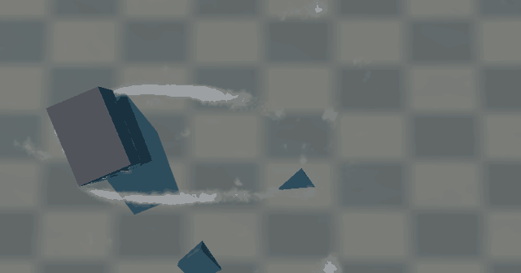

*White water: foam peels off both sides of the rock.*

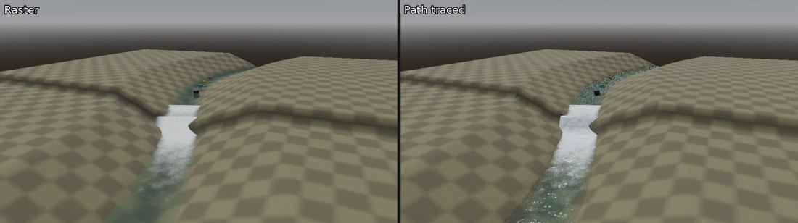

*Rivers: the cascade and the white water below it.*

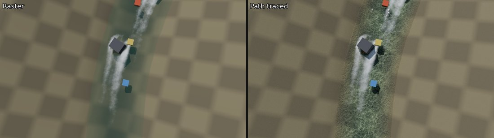

*Rivers round rocks: foam trails behind the rock.*

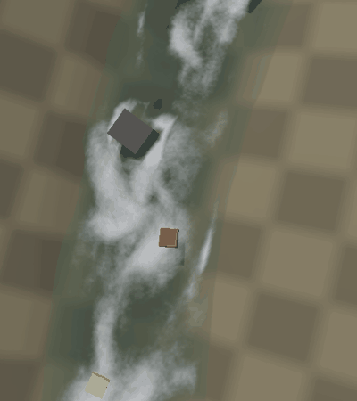

*River live flow: the wake swings behind the rock.*

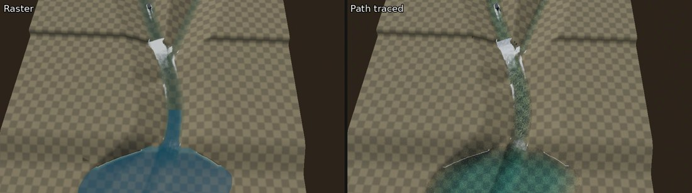

*River joins: two streams merge and spread into the lake.*

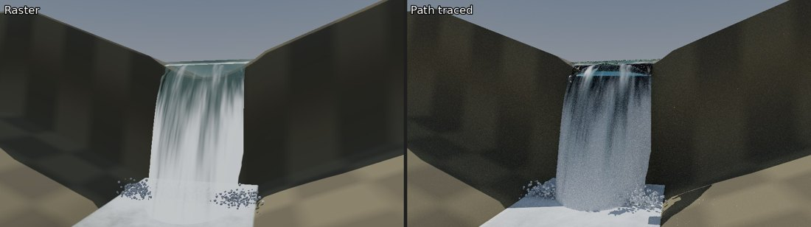

*Waterfall: the sheet breaks up into white water above the pool.*

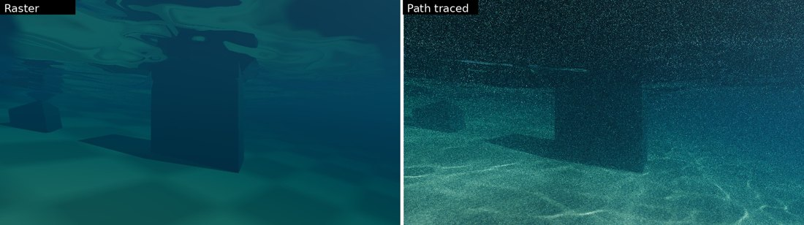

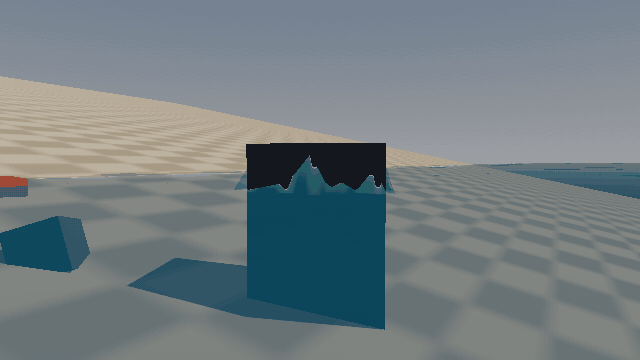

*Under water: light scattering and the surface seen from below.*

</details>

### Exposure
- **Histogram metering** (`rendering/camera/auto_exposure/metering`): lamps in view no longer darken the scene.
- **Dark-scene key** (`dark_scene_luminance`): night stays night.
- **Local exposure** (`local_highlight_contrast`, `local_shadow_contrast`).

### DLSS Ray Reconstruction
- DLSS 4.5 (`rendering/streamline/dlss_ray_reconstruction_preset`).
- Continuous thin rain and correct blending over its output; frame generation fixes.

### Physics (PhysX 5)
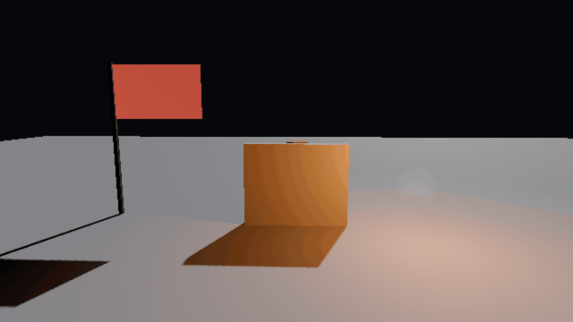

Windows x64 and Linux x86_64. Choose `PhysX` or `Jolt Physics` in **Project Settings > Physics > 3D > Physics Engine**.
- Either engine: tearable cloth, skinned cloth, Blast destruction, Flow smoke and fire, ocean buoyancy, compute-shader fluids.
- PhysX only: vehicles, CUDA fluids and deformables.
- **Path-traced smoke and fire** (`rendering/pathtracing/simulated_gas`).
- **Cloth tearing** (`PhysXCloth3D.tear_factor`, `physics/physx_3d/cloth/tearing`): overstretched edges split and the rip runs.

  <details><summary>Clip: a ribbon rips off its post and a flag frays</summary>

  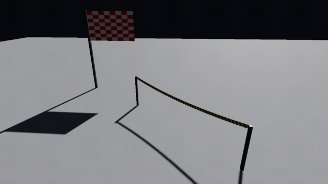

  </details>

- Builds without the SDKs skip the module (`modules/godot_physx/README.md`).

### Other
- Cached shadows, time-sliced reflection probes; `is_pathtracing_ready()`, video memory queries; leak, crash and device-fault fixes.

## Comparisons

Scenes: [docs/media/showcase](docs/media/showcase) and [docs/media/light-selection](docs/media/light-selection).

<details>
<summary>Glass shadows: NVIDIA-RTX/godot vs Berlenga</summary>

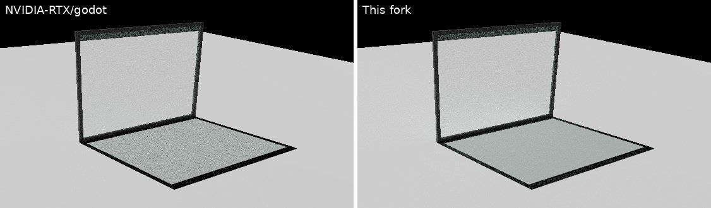
</details>

<details>
<summary>Texture filtering: NVIDIA-RTX/godot, Berlenga, raster</summary>

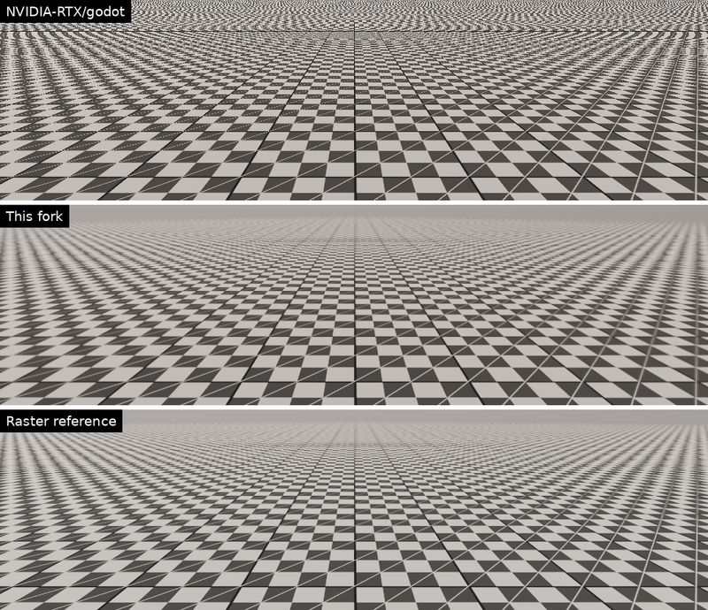
</details>

<details>
<summary>Emissive lights off vs on</summary>

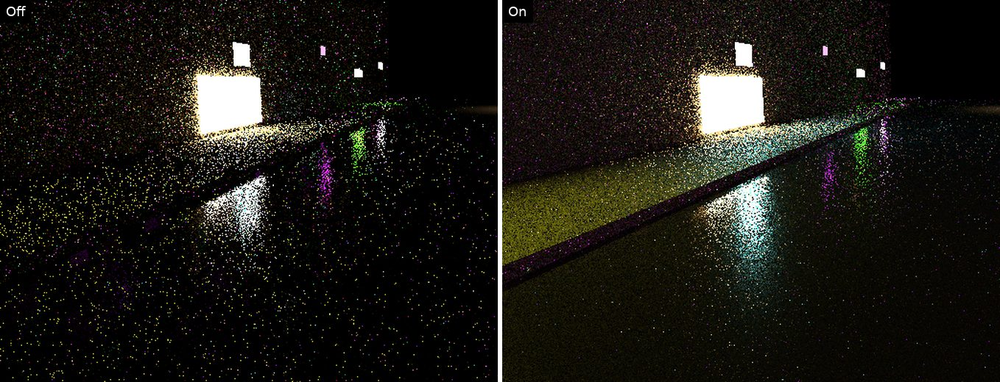

Look at the pavement under the window.
</details>

<details>
<summary>Light visibility memory off vs on</summary>

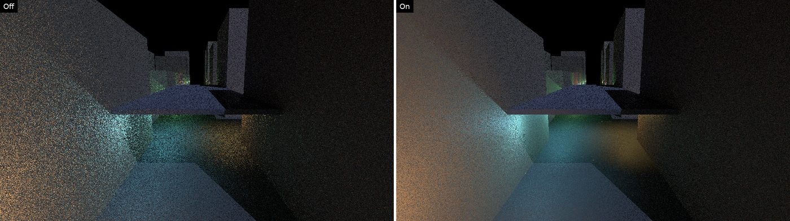
</details>

<details>
<summary>Radiance cache off vs on, equal time</summary>

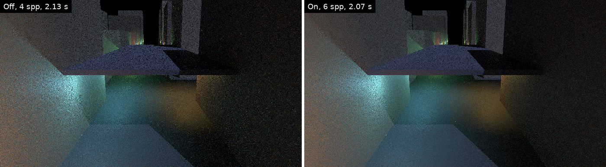
</details>

<details>
<summary>PhysX scene path traced</summary>

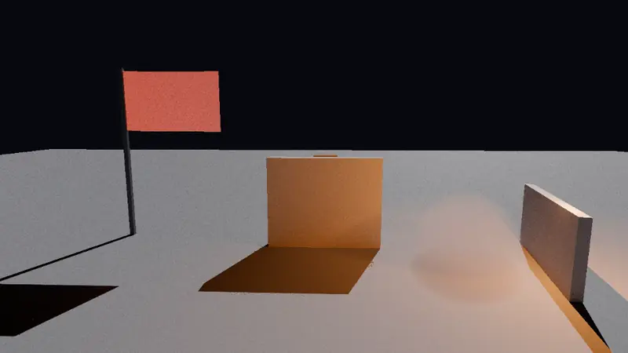
</details>

<details>
<summary>65 km from the origin: absolute vs camera-relative</summary>

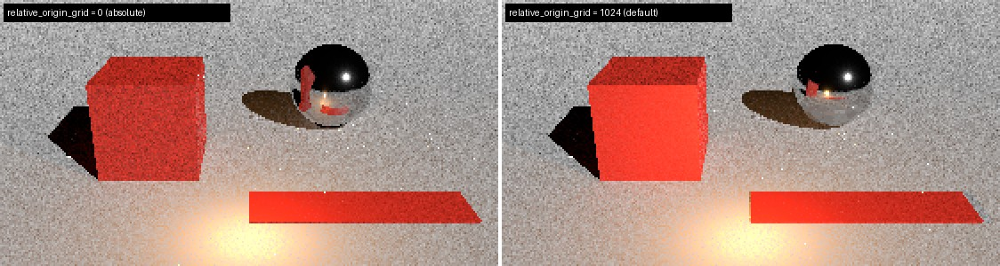
</details>

<details>
<summary>Exposure: average, histogram, dark-scene key</summary>

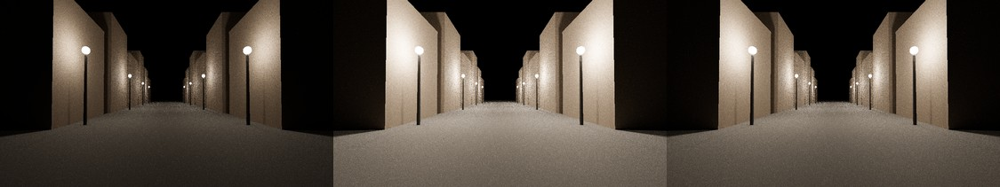
</details>

<details>
<summary>Local exposure off vs on</summary>

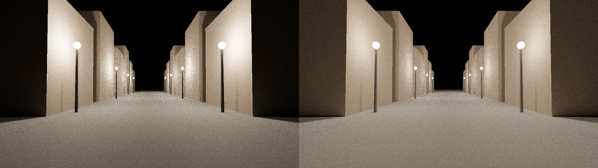
</details>

## Open worlds

Target: tens of thousands of objects over kilometres, mostly static.

- **Camera-relative tracing** (`rendering/pathtracing/relative_origin_grid`): exact shadows and reflections far from the origin.
- **Persistent instances** (`rendering/pathtracing/persistent_instances`): unchanged objects and MultiMeshes cost no per-frame work.
- **Off-screen culling** (`rendering/pathtracing/cull_max_distance`, `cull_min_size`): small or distant unseen objects leave the trace.
- **Opacity micromaps** (`rendering/pathtracing/opacity_micromaps`): cut-out foliage traced without any-hit shaders.
- **Mesh LOD in the path tracer** (`rendering/pathtracing/mesh_lod`).
- **Terrain deformation** (`TerrainDeformer3D`, `TerrainBrush3D`): non-destructive height brushes (rivers, craters, plots) over Terrain3D or a height map; moving a brush restores the ground.

Settings for a large world, in `project.godot`:

```ini
[rendering]
pathtracing/relative_origin_grid=1024.0
pathtracing/persistent_instances=true
pathtracing/cull_max_distance=500.0
pathtracing/cull_min_size=0.1
pathtracing/opacity_micromaps=true
```

Test scene (2 km, prints timing and memory):

```sh
godot --path docs/bench/open_world --gpu-profile -- --count=100000 --set=rendering/pathtracing/persistent_instances:1
```

Options: `--movers=N`, `--churn=N`, `--recolor`, `--fly=S`, `--multimesh=M` (MultiMesh tiles of M meters), `--mmmove=N`, `--raster`, `--out=frame.png`. Design and measurements: [open-world geometry](docs/ideas/open-world-geometry.md), [persistent instances](docs/ideas/persistent-instances.md), [instanced forests](docs/ideas/instanced-forests.md), [opacity micromaps](docs/ideas/opacity-micromaps.md).

## References

Code: [NVIDIA-RTX/godot](https://github.com/NVIDIA-RTX/godot) (path tracer, DLSS); [uno1982/godot](https://github.com/uno1982/godot) `feature/physx5-module` (Wild Ox Studios, MIT); [NVIDIA-Omniverse/PhysX](https://github.com/NVIDIA-Omniverse/PhysX) (BSD-3-Clause); [valence-engine-rtx](https://github.com/Rman887/valence-engine-rtx) (camera-relative tracing, ray offset, persistent instance slots, opacity micromap bake). Papers: [docs/REFERENCES.md](docs/REFERENCES.md). Research notes: [docs/ideas](docs/ideas).

## License

MIT, like Godot. Third-party licenses in `thirdparty/` and `COPYRIGHT.txt`; NVIDIA binaries under NVIDIA's terms. Build and docs: [godotengine/godot](https://github.com/godotengine/godot), [docs.godotengine.org](https://docs.godotengine.org).

Berlenga is an independent fork and is not affiliated with or endorsed by the Godot Foundation.
