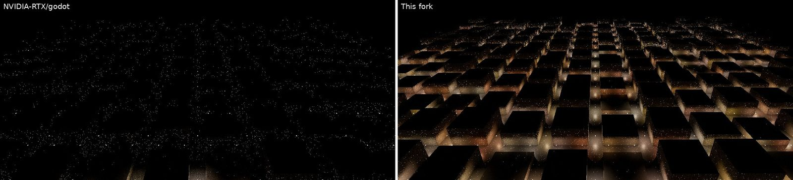

# <picture><source media="(prefers-color-scheme: dark)" srcset="docs/media/berlenga-lockup-light-text.svg"></picture>

  

Berlenga is a Godot 4 fork with Vulkan path tracing, DLSS Ray Reconstruction and a procedural natural world of linked terrain, weather, water, vegetation and snow, built for large open worlds. Based on [NVIDIA-RTX/godot](https://github.com/NVIDIA-RTX/godot).

**[Download](https://github.com/pcanilho/berlenga/releases/latest):** Windows (Ray Reconstruction: add NVIDIA's DLSS, Streamline and Reflex DLLs next to the exe), Linux x86_64/arm64 (no Ray Reconstruction), macOS (raster only, no PhysX); export templates for Windows and Linux with PhysX (install the `.tpz` from Manage Export Templates). **Docs:** [berlenga.canilho.net](https://berlenga.canilho.net/). **Changes:** [CHANGELOG.md](CHANGELOG.md).

*1024 lights, 16 samples per pixel. Left: NVIDIA-RTX/godot. Right: Berlenga. Images are raw path tracer output, mostly CPU-rendered, without denoiser or Ray Reconstruction.*

## At a glance

**Rendering**

- **[Lighting](https://berlenga.canilho.net/features/lighting/)**: 4096 path-traced lights (upstream 64); emissive surfaces count as lights; light visibility memory, radiance cache, light reuse.
- **[Materials](https://berlenga.canilho.net/features/materials/)**: clearcoat, back lighting, thin-glass transmission, subsurface scattering; textures filter like raster.
- **[Exposure](https://berlenga.canilho.net/features/exposure/)**: histogram metering, dark-scene key, local exposure.
- **[DLSS Ray Reconstruction](https://berlenga.canilho.net/features/dlss-ray-reconstruction/)**: DLSS 4.5 Ray Reconstruction; pixel antialiasing when it is off.

**World**

- **[Terrain](https://berlenga.canilho.net/features/terrain/)**: mountain ranges raised and eroded per seed, with geology, river networks, coasts and lakes; non-destructive height brushes; terrain data maps.
- **[Rocks](https://berlenga.canilho.net/features/rocks/)**: rocks and stones as geometry, broken along each rock type's joints and weathered; placed by rockfall, scree, glacial till, rivers, shores and cliffs.
- **[Water](https://berlenga.canilho.net/features/water/)**: refraction, murky water, caustics, ocean and storm seas, currents, boat wakes, white water, rivers and waterfalls, live water that floods and drains, shore waves, camera under water.
- **[Vegetation](https://berlenga.canilho.net/features/vegetation/)**: biome plant placement from terrain maps; grass and generated meadow, forest floor, mushroom, stone and wetland plants in the weather's wind; GPU-placed instances seen by path tracing; per-instance bones.
- **[Trees](https://berlenga.canilho.net/features/trees/)**: trees and woody shrubs grown by light competition, 31 species in ten stand types; bark, moss, lichen, climbers, seasons, pollards, old trees, deadwood and fungi; weather wind out to 1 km, colliders and touch.
- **[Snow](https://berlenga.canilho.net/features/snow/)**: a snowpack from the weather map that falls, settles, melts, slides and drifts; deep snow with tracks; baked winters and cornices.
- **[Weather](https://berlenga.canilho.net/features/weather/)**: one weather map for wind, storms, rain, wet surfaces and puddles, driving water, cloth and hair.
- **[Sky and clouds](https://berlenga.canilho.net/features/sky-and-clouds/)**: sun and moon set by date, time and place; a scattering atmosphere with twilight; a cloud layer from the weather map, reprojected, path traced, with shadows on the ground.

**Simulation**

- **[Physics (PhysX 5)](https://berlenga.canilho.net/features/physics/)**: PhysX 5 alongside Jolt: cloth, tearing, destruction, path-traced smoke, lit smoke in raster.
- **[Hair](https://berlenga.canilho.net/features/hair/)**: fibre shading, strand grooms, TressFX strand simulation with body collision.

**Engine**

- **[Open worlds](https://berlenga.canilho.net/features/open-worlds/)**: camera-relative tracing, persistent instances, culling, mesh LOD.
- **[Other](https://berlenga.canilho.net/features/other/)**: cached shadows, time-sliced reflection probes, video memory queries, fixes.

Every feature with its setting and images: [features](https://berlenga.canilho.net/features/).

## References

Code: [NVIDIA-RTX/godot](https://github.com/NVIDIA-RTX/godot) (path tracer, DLSS); [uno1982/godot](https://github.com/uno1982/godot) `feature/physx5-module` (Wild Ox Studios, MIT); [NVIDIA-Omniverse/PhysX](https://github.com/NVIDIA-Omniverse/PhysX) (BSD-3-Clause); [GPUOpen-Effects/TressFX](https://github.com/GPUOpen-Effects/TressFX) (AMD, MIT; strand hair simulation and rendering); [valence-engine-rtx](https://github.com/Rman887/valence-engine-rtx) (camera-relative tracing, ray offset, persistent instance slots, opacity micromap bake). Showcase art: [Poly Haven](https://polyhaven.com) (CC0; wooden bucket by James Ray Cock, mossy rocks by Kless Gyzen, dry branches by Rico Cilliers, tiles, plaster, metal plate, forest and burned ground; ground layer scans Dark Rock 02 by Amal Kumar, Rocks Ground 02 by Rob Tuytel, Forest Ground 06 and Sand 03 by Charlotte Baglioni, Gravelly Sand by Dario Barresi; overlay scans Rock Face 03 by Dario Barresi and Rico Cilliers, Rock Surface by Amal Kumar, Dry Ground 01 and Brown Mud 02 by Rob Tuytel, Mud Cracked Dry Riverbed 002 by Dario Barresi and Dimitrios Savva, Coast Sand 04 by Rob Tuytel and Dario Barresi); [ambientCG](https://ambientcg.com) (CC0; Grass 001, the straw cover's detail). Data: [Yale Bright Star Catalogue](http://tdc-www.harvard.edu/catalogs/bsc5.html), 5th ed. (Hoffleit and Warren, public domain; the night sky's stars). Papers: [docs/REFERENCES.md](docs/REFERENCES.md). Research notes: [docs/ideas](docs/ideas).

## License

MIT, like Godot. Third-party licenses in `thirdparty/` and `COPYRIGHT.txt`; NVIDIA binaries under NVIDIA's terms. Build and docs: [godotengine/godot](https://github.com/godotengine/godot), [docs.godotengine.org](https://docs.godotengine.org).

Berlenga is an independent fork and is not affiliated with or endorsed by the Godot Foundation.
